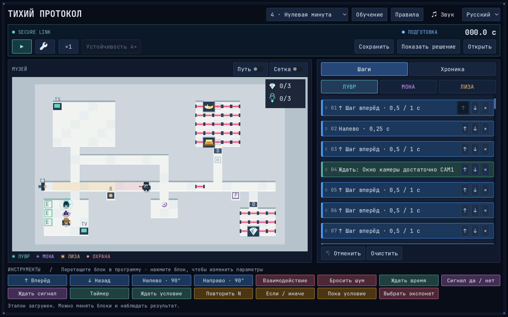
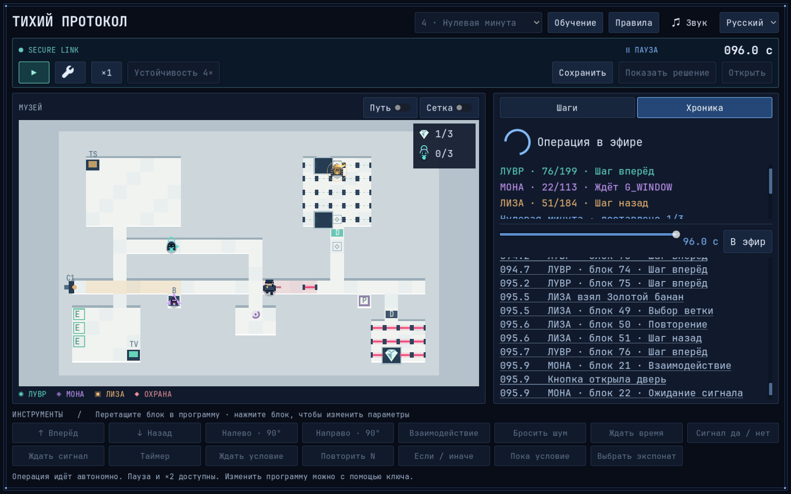
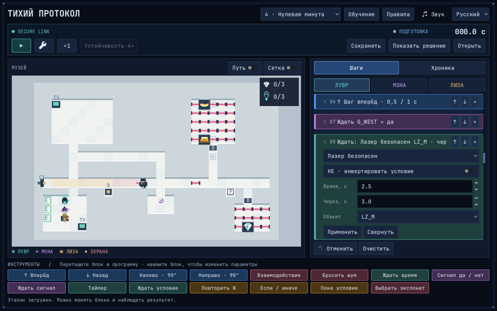
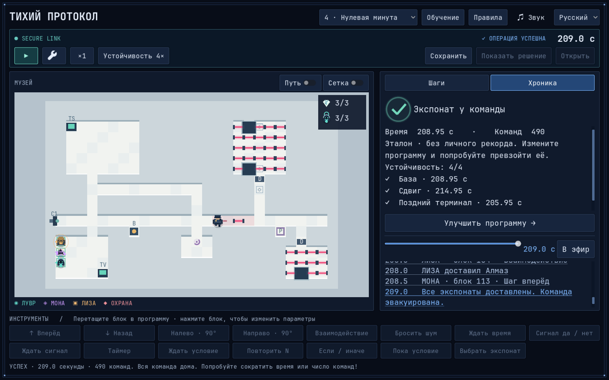

# Тихий протокол · Silent Protocol

**Команда «САНА» · Gambit Hackathon 2026 · AUTOMATE IT!**

> Запрограммируй ограбление. Запусти. Найди ошибку. Сделай план лучше.

2D-головоломка об автоматизации музейного ограбления. Игрок составляет программы для трёх роботов — **Лувра, Моны и Лизы** — и наблюдает, как они самостоятельно взламывают защиту, отвлекают охрану и выносят экспонаты. У всех одинаковые способности; роли определяются программами.

*A deterministic programming heist puzzle built with Godot 4.5.1 and GDScript. Three robots, visual command blocks, signals, conditions, loops, timed security windows and replayable execution.*

[Скачать игру для macOS / Windows](https://github.com/batyrkekw/silent-protocol/releases/latest) · [Промпт презентации](docs/presentation-prompt.md) · [Проверки финала](design/zero_minute/REPORT.md)



## Почему это автоматизация

Игрок не управляет роботом в реальном времени и не кликает точку назначения. Он строит алгоритм из относительных шагов, поворотов и действий. После запуска программы работают самостоятельно и согласуют действия через сигналы и состояния мира.

- **Условия**: готов ли терминал, выключена ли камера, достаточно ли окна лазера, занята ли плита, завершено ли отвлечение.
- **Циклы и ветвления**: повторная доставка, поиск выбранной витрины, разные действия по ситуации.
- **Сигналы да/нет**: передача готовности между роботами со следующего тика.
- **Таймеры**: повторное нажатие кнопки до закрытия двери, ожидания внутри программы.
- **Проверка устойчивости**: та же программа запускается при других начальных фазах защиты.

Простая запись удачного расписания оказывается хрупкой. В финальном уровне условный эталон проходит **4/4 сценария**, а его версия с фиксированными ожиданиями — **1/4**.

## Начать играть

1. Скачайте нужный файл в [Releases](https://github.com/batyrkekw/silent-protocol/releases/latest).
2. **macOS**: распакуйте `SilentProtocol-macOS.zip` и откройте `Silent Protocol.app`.
3. **Windows x64**: откройте `SilentProtocol.exe`. Ресурсы встроены; Godot устанавливать не нужно.
4. Пройдите первый учебный этап или выберите ограбление в верхнем списке.
5. Перетаскивайте блоки из нижней палитры. Нажмите карточку для изменения параметров.
6. **▶ / Ⅱ** запускает и приостанавливает исполнение; **гаечный ключ** возвращает к редактированию.
7. После неудачи откройте хронику, выберите событие и исправьте программу. После победы попробуйте улучшить время, число команд и устойчивость.

«Показать решение» загружает редактируемый эталон. Интро пропускается двумя отдельными нажатиями пробела. Доступны русский, казахский и английский языки.

macOS-сборка проверена запуском через LaunchServices и имеет локальную ad-hoc подпись, без Developer ID/notarization. Windows-пакет проверен движком на macOS; нативная проверка на Windows пока не выполнена.

## Кампания

| Пункт меню | Содержание |
|---|---|
| Туториал | Шесть небольших комнат: движение, терминал, плита, сигналы, отвлечение, таймеры и циклы. Обучение необязательное. |
| Закрытая галерея | Кооперация, окна защиты и доставка экспоната. |
| Ночная смена | Три экспоната, неподвижный охранный пост, повторные отвлечения и три сценария устойчивости. |
| Нулевая минута | Финальная карта 28×18: галерея и хранилище, два терминала, тяжёлая дверь, плита, камера, патруль и четыре сценария. |

В финале нужно доставить **слиток, золотой банан и алмаз**, а затем вывести всех троих роботов. Дверь галереи не удерживается роботом: первый допуск кнопки — 60 тиков после взлома, время открытия — 120 тиков. Для дальнего экспоната нужно повторное нажатие. Геометрические и временные ограничения требуют трёх отдельных ролей.



## Редактор и разбор

Все 15 инструментов доступны в нижней палитре. Вложенные блоки переносятся вместе с содержимым. Есть отмена изменений, локальные сохранения и редактирование параметров внутри карточек.

Хроника находится в боковой панели, показывает события и позволяет перематывать запись. После победы доступны показатели результата, локальные рекорды и видимая проверка устойчивости.





## Технологии и правила времени

- **Godot 4.5.1**, **GDScript**, Compatibility renderer.
- Детерминированная симуляция: **20 тиков/с**. Один план и одинаковое начальное состояние дают одинаковый журнал.
- Шаг: **10 тиков**, с добычей — **20**; поворот — **5**; получение предмета — **40**.
- Исполнение программы отделено от визуальной интерполяции, звука и интерфейса.
- Данные карт и эталонных программ хранятся в JSON.
- Игра работает локально, без аккаунта и серверной части.

```text
scripts/simulation_v5.gd   — мир, интерпретатор, устройства и обнаружение
scripts/block_editor.gd    — редактор перетаскиваемых команд
scripts/board.gd           — отрисовка музея
scripts/main.gd            — интерфейс и управление запуском
scripts/robustness_runner.gd — последовательный прогон сценариев
data/levels/              — 9 карт: 6 учебных + 3 ограбления
data/programs/            — условные и хрупкие эталоны
tests/                    — проверки симуляции и интерфейса
docs/                     — скриншоты и промпт презентации
```

## Запуск исходников

Установите Godot **4.5.1**, откройте `project.godot` и нажмите F6/F5 для запуска сцены/проекта. В macOS также можно выполнить:

```sh
./launch.command
```

Проверки:

```sh
./test.command
```

Для скриптов можно указать движок через `GODOT_BIN`. Кеш Godot, сам движок, локальные настройки и готовые бинарники не хранятся в Git.

## Сборка

Установите официальные export templates **4.5.1**. На macOS:

```sh
./build_all.command
```

Команда создаёт `.app`, Windows `.exe` со встроенным PCK и общий ZIP в родительской папке. macOS-упаковка использует системный `codesign`; это не кроссплатформенный установщик.

Для отдельного Windows-экспорта:

```sh
Godot --headless --path . --export-release "Windows Desktop" ../SilentProtocol.exe
```

## Проверено

- 292 регрессионные проверки прежней симуляции, интерфейса, редактора, интро и восстановления после ошибки.
- 40 проверок финального уровня, дополнительно — геометрия, обзор, перебор прохода через нишу и интерфейс четвёртого уровня.
- Все 10 пунктов проверки финала: [отчёт с границами доказательств](design/zero_minute/REPORT.md), [машинный результат](design/zero_minute/verification.json).
- Условный эталон финала: **4179 / 4299 / 4119 / 4239 тиков** в четырёх сценариях.
- Перебор 3721 расписания прохода через нишу: без добычи найден проход без шума; с добычей на проверенной сетке ожиданий проходов нет. Это ограниченный перебор, а не полный перебор всех возможных программ.
- Ресурсы обеих сборок: все девять карт проходят эталон. Интерфейс проверен с RU/KK/EN; тест английского интерфейса не нашёл непереведённых русских строк.

## Авторы и компоненты

Проект команды **«САНА»** для Gambit Hackathon 2026, трек **AUTOMATE IT!**.

Лицензии сторонних компонентов сохранены в [third_party.md](third_party.md), `licenses/` и `assets/fonts/`. Публичная публикация этого репозитория сама по себе не предоставляет отдельную лицензию на авторский код проекта.
